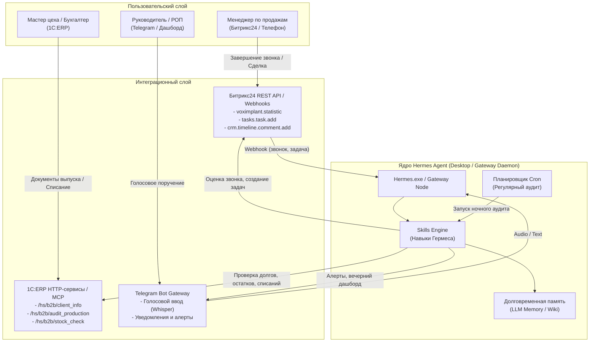

# 🏛️ Архитектурная концепция интеграции Hermes Agent с Битрикс24 и 1С:ERP

Данный документ описывает целевую архитектуру развёртывания **Hermes Agent** (Desktop / Gateway / Headless) в контуре производственно-торговой B2B-компании.

---

## 1. Общая схема взаимодействия (Data Flow)



---

## 2. Компоненты решения

### А. Hermes Desktop (`Hermes.exe` / Gateway Daemon)
* Разворачивается на выделенном сервере компании (Windows Server или Linux Docker) либо локально на рабочих местах руководителей.
* Работает в режиме непрерывного демона (24/7):
  - Принимает входящие вебхуки от Битрикс24 при завершении звонков или смене стадий сделок.
  - По расписанию (`cron`) запускает регулярные проверки регистров 1С:ERP.
  - Поддерживает сессию с Telegram Bot API для оперативного взаимодействия.

### Б. Модуль интеграции с Битрикс24
* **Анализ звонков:** 
  1. Перехват события `ONVOXIMPLANTCALLFINISHED`.
  2. Загрузка файла записи разговора.
  3. Транскрибация речи в текст (Whisper / Cloud STT).
  4. Анализ текста диалога языковой моделью Гермеса по чеклисту (5 критериев).
  5. Запись структурированного резюме в карточку CRM через `crm.timeline.comment.add`.
  6. При оценке ниже порога (или отсутствии фиксации следующего шага) — автоматическое создание задачи `tasks.task.add` ответственному менеджеру с дедлайном 30 минут.

### В. Модуль связки с 1С:ERP
* Реализуется через типовой HTTP-сервис 1С:ERP (в расширении без снятия с поддержки):
  - `GET /hs/b2b/partner/{id}/tactical-summary`: возвращает остаток дебиторской задолженности, просрочку, свободный остаток готовой продукции на складе и наличие необходимого металлопроката/сырья.
  - `GET /hs/b2b/audit/manufacturing-discrepancies`: возвращает список зависших заказов на производство (без статуса «К производству» > 24 ч) и выпусков без списания материалов.
* Гермес использует эти данные в двух режимах:
  - **Co-Pilot для менеджера:** формирование готовой подсказки по условиям оплаты и отгрузки при согласовании заказа.
  - **Supervisor для директора:** автоматический аудит и выставление задач ответственным сотрудникам цеха/бухгалтерии при нарушениях регламентов.

### Г. Модуль голосового Telegram-интерфейса
* Приём голосовых сообщений руководителей.
* Синтаксический разбор поручения: определение исполнителя, срока (дедлайна), приоритета и описания задачи.
* Постановка задачи в Битрикс24 и подтверждение в чат: *«Задача #452 поставлена инженеру Сидорову на 16:00»*.

---

## 3. Навыки Hermes (Skills)

Проект включает готовые модули в стандарте Hermes Skills, расположенные в папке `skills/`:
1. `skills/b2b-sales-auditor/SKILL.md` — аудит звонков и контроль менеджеров в CRM.
2. `skills/erp-copilot/SKILL.md` — выдача тактических рекомендаций менеджерам на базе остатков и дебиторки 1С:ERP.
3. `skills/erp-production-auditor/SKILL.md` — поиск зависших заказов и нарушений списания материалов в 1С.
4. `skills/voice-task-dispatcher/SKILL.md` — парсинг голосовых команд и создание задач в Битрикс24.

---

## 4. Порядок быстрого развёртывания в вашей инфраструктуре

1. **Клонирование репозитория в каталог навыков Гермеса:**
   ```bash
   git clone https://github.com/antoshik86/hermes-b2b-supervisor.git
   ```
2. **Настройка переменных окружения (`.env`):**
   - `BITRIX_WEBHOOK_URL` — входящий вебхук Битрикс24 (права: crm, tasks, telephony).
   - `ERP_1C_BASE_URL` — адрес публикации HTTP-сервисов 1С:ERP.
   - `TELEGRAM_BOT_TOKEN` — токен бота для отчетов и голосовых поручений.
3. **Подключение навыков к Hermes:**
   - Навыки из папки `skills/` копируются в директорию `~/.hermes/skills/` или `plugins/`.
   - Гермес автоматически подхватывает триггеры и инструменты для вызова функций.
